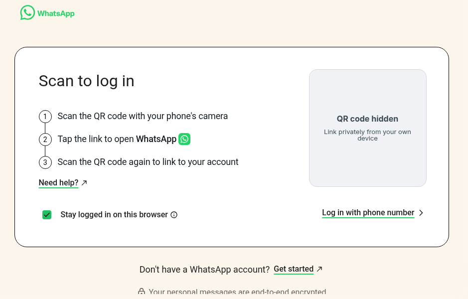

# Fedora WhatsApp

I built this to use WhatsApp on Fedora. It opens the official [WhatsApp Web](https://web.whatsapp.com/) client in its own window and keeps your login between restarts. Rust handles the launcher, GTK4/libadwaita handles native dialogs, and Electron/Chromium runs the web client.

This is an unofficial project. It has no affiliation with WhatsApp, Meta or the Fedora Project.



*The login screen in the app. I hid the QR code for the screenshot. No account was linked.*

## Other Linux distros

If you want to use it on another Linux distro, you can ask Codex or Claude Code to help make it work there. If you don't have either or want me to do it, [contact me by opening an issue](https://github.com/ayexito/fedora-whatsapp/issues/new) with your distro and version. I'll adapt it for you.

Only Fedora 44 x86_64 has been tested so far. Each port needs to be built and checked on its target distro.

## Where it's at

Version 0.1.4 is an early build. You need to build it from source for now.

I've checked startup, the official login screen, saved sessions, opening the app from the launcher, reusing one window, and the renderer sandbox on Fedora 44 x86_64 with Hyprland Wayland. I also reopened a linked account across restarts and tested navigation and scrolling.

The app has close, minimize and maximize/restore buttons, a visible Application menu, reload/quit shortcuts, a native About dialog, attachment downloads with a Save dialog, and remembered permissions for media and desktop notifications. Web links open in your default browser. Supported saved documents and media can be opened with a separate click after downloading. Close hides the window and keeps WhatsApp running in the background. Reopen it from the launcher; **Application → Quitter** or **Ctrl+Q** quits completely. A tray icon restores the window and offers Quit on desktops with tray support. Preferences and start on login still need work.

Sending and receiving messages, voice/video calls, GNOME Wayland, X11 and long-running use still need testing. There is no RPM or Flatpak package yet.

## Install on Fedora 44 (x86_64)

Open a terminal and run these commands. `sudo dnf` installs the dependencies; the app and Electron are installed for your user.

```sh
sudo dnf install git cargo rust rustfmt gcc pkgconf-pkg-config gtk4-devel libadwaita-devel nodejs npm gtk3 nss alsa-lib cups-libs libdrm mesa-libgbm desktop-file-utils
git clone https://github.com/ayexito/fedora-whatsapp.git
cd fedora-whatsapp
npm install --global --prefix "$HOME/.local/npm-global" electron@44.7.2
cargo build --locked
```

When the build finishes successfully, stay in that directory and add it to your app launcher:

```sh
install -Dm755 target/debug/whatsapp-desktop "$HOME/.local/bin/whatsapp-desktop"
install -Dm644 data/io.github.whatsapp_fedora.Desktop.svg "$HOME/.local/share/icons/hicolor/scalable/apps/io.github.whatsapp_fedora.Desktop.svg"
desktop-file-install --dir="$HOME/.local/share/applications" --set-key=Exec --set-value="\"$HOME/.local/bin/whatsapp-desktop\"" data/io.github.whatsapp_fedora.Desktop.desktop
desktop-file-validate "$HOME/.local/share/applications/io.github.whatsapp_fedora.Desktop.desktop"
update-desktop-database "$HOME/.local/share/applications"
gtk-update-icon-cache --force --ignore-theme-index "$HOME/.local/share/icons/hicolor"
```

Search for "Fedora WhatsApp" in your launcher. You can also start it with:

```sh
"$HOME/.local/bin/whatsapp-desktop"
```

Link your account using the QR code in the app. After installation, you can open it from the launcher without a terminal. Keep the user-level Electron installation above; the app still needs it.

To update, quit the app, rebuild it, then repeat the install commands. Your saved session stays in place.

To uninstall, quit the app and remove these three files, then rerun the two database/cache commands above:

- `~/.local/bin/whatsapp-desktop`
- `~/.local/share/applications/io.github.whatsapp_fedora.Desktop.desktop`
- `~/.local/share/icons/hicolor/scalable/apps/io.github.whatsapp_fedora.Desktop.svg`

This leaves your session data on disk. Revoke the linked device from WhatsApp on your phone if you want to end its access.

## Build with Podman instead

After cloning the repository and installing the desktop dependencies and Electron above, you can use rootless Podman for the Rust build:

```sh
sudo dnf install podman
./scripts/build-fedora.sh --locked
podman run --rm -v "$PWD:/work:z" -v whatsapp-cargo-cache:/root/.cargo localhost/whatsapp-fedora-builder cargo test --locked
```

Then use the same launcher-install commands above. The build runs in the container; the app runs on your desktop. The Fedora image digest and Cargo.lock are pinned, but Fedora repository packages can change between builds.

The app uses Electron 44.7.2. Keep it updated for security fixes. For development, `WA_ELECTRON_BINARY` can point to another trusted Electron executable. Otherwise, the launcher looks in `/usr/lib64/whatsapp-desktop/electron/electron`, then `~/.local/npm-global/lib/node_modules/electron/dist/electron`.

## Login and privacy

Link your account through WhatsApp's normal QR process. The app stores the Chromium profile in `$XDG_DATA_HOME/io.github.whatsapp_fedora.Desktop/chromium`, usually `~/.local/share/io.github.whatsapp_fedora.Desktop/chromium`. The app's data/cache folders have mode 0700, so other Linux users can't normally read them. That does not protect against root or malware running as your user. Disk and keyring encryption haven't been independently checked.

WhatsApp provides the messaging and encryption. This app has no developer backend or added tracker. The web page runs with sandboxing, context isolation and TLS checks enabled, without Node integration or a native IPC bridge.

Never upload your profile, cache, QR codes or account logs to GitHub or an AI chat. Read [SECURITY.md](SECURITY.md) before sharing diagnostics.

## Checks and known issues

```sh
cargo test --locked
node --test tests/security.test.cjs
```

These tests check private storage permissions, trusted URLs, renderer isolation, downloads, external links, media consent, persistence and revocation, plus window resizing, tray actions and close/reopen/quit behavior. They do not verify message delivery or calling. After building, check login, typing, resizing and reconnection on your own machine.

To save an attachment, click its download button in WhatsApp, choose a folder and filename, then click **Enregistrer** (Save). Document links that open a WhatsApp blob popup also use this Save dialog. Existing files require overwrite confirmation. The completion dialog offers **Afficher dans le dossier** (Show in folder) and, for supported documents and media, **Ouvrir** (Open) in the default application. Files never open automatically. Cancelling the Save dialog cancels that download. If a download is interrupted, retry it from WhatsApp. Keep the app open until the download finishes.

An isolated Chromium profile was used to check synthetic HTTPS/blob downloads, blob document popups, cancellation, an unwritable destination and the explicit Open action. External links from the main page and popups were each dispatched once to a browser-opening test spy. Synthetic audio/video capture produced recording bytes; permission queries stayed granted after restarting without another prompt and became denied after revocation. These checks used synthetic media and intercepted desktop-opening calls; hardware capture, actual calls and default-application dispatch still need testing.

The local title bar supplies all three window buttons even when the desktop only shows Close. Its controls are separate from the WhatsApp page. The chat view follows the native content area's bounds as the compositor lays it out, including maximize/restore transitions. The compositor still controls window placement and whether a window floats or tiles. Close keeps the loaded page and session alive; reopening the app shows the same window. Use **Application → Quitter** or **Ctrl+Q** to stop it completely. An isolated profile passed two Super+F maximize/restore cycles on Hyprland Wayland: the native view and web viewport stayed aligned, and a test draft survived closing and reopening. Background mode requires the desktop session to stay running and does not keep the computer awake.

On desktops with a system tray, the WhatsApp icon stays there while the app is running. The tray was checked on Hyprland with Quickshell using an isolated profile: activation and Open restored the same document, and Quit exited. Click it to restore the window; right-click for **Ouvrir Fedora WhatsApp** or **Quitter**. If your desktop does not display tray icons, you can still reopen the app from its launcher.

To enable desktop notifications, choose **Application → Autoriser les notifications…**, then **Autoriser et mémoriser**. This reloads WhatsApp; enable notifications in WhatsApp's own settings too if requested. You can turn them off with **Application → Désactiver les notifications et recharger**. Notifications use the official web client's browser API and the desktop notification service; the app does not create a second copy. Use WhatsApp's notification settings for previews and your desktop settings for Do Not Disturb. Close and Minimize keep the app running; notifications stop after Quit. A synthetic web notification reached the desktop service while the window was hidden, triggered by a server-sent event rather than polling. Notification consent also persisted across restart. Incoming-message delivery, notification clicks and GNOME Do Not Disturb still need a manual check.

HTTP and HTTPS links open in your default browser; custom links such as `file:` or application-specific schemes remain blocked.

If scrolling is slow, quit the app completely with **Ctrl+Q** and create an empty `software-rendering` file inside its private Chromium profile. Remove only that file, with the app fully quit, to restore hardware acceleration. This helped on the tested Intel/NVIDIA Hyprland setup; other profiles keep hardware acceleration by default. Video CPU use and battery effects still need testing.

On the first successful WhatsApp load, a native dialog asks whether to allow the microphone and camera. Choose **Autoriser et mémoriser** (Allow and remember) or **Refuser** (Deny). Your choice is remembered on this computer, so setup does not ask again on every launch; the dialog itself starts no capture. Use **Ctrl+Shift+M** for the microphone or **Ctrl+Shift+V** for the microphone and camera to change a denied choice. These controls are also in the visible **Application** menu. Accepting reloads WhatsApp so it can detect the permissions. Speaker selection has a separate permission. Use **Application → Révoquer les autorisations audio/vidéo et recharger** to remove saved grants and stop media by reloading the page.

Use WhatsApp's own device selector when available, or Fedora's sound settings for the default microphone and output. WhatsApp [announced Web voice/video calling, including group calls, in July 2026](https://blog.whatsapp.com/introducing-web-calling-on-whatsapp-plus-more-new-updates), with a gradual rollout. Availability still depends on your account and supported browser version. Working media permissions alone do not establish that this app can complete calls.
